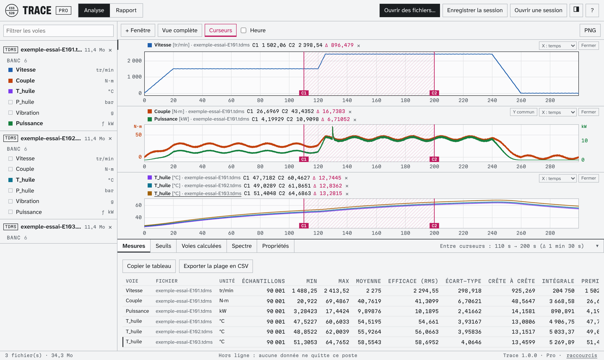

# Trace — visionneuse TDMS, MDF4 (MF4) et CSV hors ligne, édition gratuite

Ouvrez vos fichiers de mesures **TDMS** (NI LabVIEW, FlexLogger, DAQmx), **MDF4 / MF4** (ASAM, enregistreurs CAN) et **CSV** dans un seul fichier HTML : pas d'installation, pas de droits administrateur, pas de compte, aucune donnée envoyée sur le réseau.

*Capture de Trace Pro. L'édition gratuite a la même interface de lecture et de mesure ; la voie calculée « Puissance » et les onglets Seuils, Voies calculées, Spectre et Rapport sont réservés à Trace Pro.*

## Télécharger

Téléchargez [`trace-gratuit.html`](trace-gratuit.html) (bouton « Download raw file »), puis double-cliquez dessus : il s'ouvre dans Edge, Chrome, Firefox ou Safari. Des fichiers d'essai sont dans [`exemples/`](exemples/).

## Ce que fait l'édition gratuite

* Lecture TDMS, MDF 4.0 à 4.2 et CSV (séparateur `;`, virgule décimale, dates françaises), sans limite de taille.
* Courbes sur des dizaines de millions de points, 8 fenêtres synchronisées, zoom à la souris (temps et axe Y), courbes XY.
* Curseurs C1 / C2 : valeurs, écarts, statistiques entre curseurs (min, max, moyenne, RMS, écart-type…).
* Propriétés des fichiers, groupes et voies.
* Export CSV de la plage choisie et image PNG des courbes.

Version 1.0.0. Usage gratuit, y compris professionnel ([licence](LICENSE)).

## Trace Pro

Trace Pro ajoute les voies calculées (formules rejouées sur chaque fichier), la détection de seuils, le spectre FFT et le **rapport d'essai PDF**, fichier par fichier ou par lot avec une page de synthèse. Licence perpétuelle par poste : [Trace Pro](https://consignestudio.gumroad.com/l/trace-pro).

## Support

Questions et signalements : support@consignestudio.fr, ou une issue sur ce dépôt.

Code écrit avec l'assistance d'un outil d'IA, relu et vérifié par des tests ; lecteurs validés contre npTDMS et asammdf. TDMS, LabVIEW, DIAdem et DAQmx sont des marques de National Instruments / Emerson ; Trace n'en est pas affilié.
